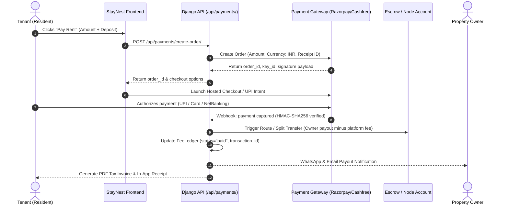

# StayNest — Technical Roadmap & Pending Features Specification

**Document Version:** 1.0.0  
**Status:** Approved for Phased Deployment  
**Scope:** Architecture and API specifications for pending core modules following the v1.0.0 secure role-partitioned release.

---

## Executive Summary

StayNest v1.0.0 establishes the verified core:
1. **Three Dedicated Operational Tiers**: Tenants, Property Owners, and Platform Administrators.
2. **Editorial Showcase & Discovery**: Transparent room inventories, 7-day nutritional food menus, and direct-to-owner booking requests without intermediary brokerage fees.
3. **Secure Authentication & Session Controls**: JWT-backed credentials, rate-limited email OTPs, role validation, and private administrative boundaries.

This document details pending modules planned for subsequent release iterations, focusing on payment infrastructure, automated compliance, and resident hardware integration.

---

## 1. Module A: Digital Payment Gateway & Rent Auto-Settlement

### 1.1 Objective
Eliminate manual bank transfers, cash tracking, and physical rent receipts by embedding a fully automated payment and settlement gateway.

### 1.2 Target Gateway Providers
* **Primary (India Domestic):** Razorpay / Cashfree Payments (supporting UPI, Credit/Debit Cards, NetBanking, and UPI AutoPay / eNACH mandate).
* **International / NRI Students:** Stripe Connect.

### 1.3 Technical Architecture & Payment Flow



### 1.4 Database Schema Additions (`core/models.py`)

```python
class PaymentOrder(models.Model):
    class Status(models.TextChoices):
        CREATED = "created", "Created"
        ATTEMPTED = "attempted", "Attempted"
        PAID = "paid", "Paid"
        FAILED = "failed", "Failed"
        REFUNDED = "refunded", "Refunded"

    order_id = models.CharField(max_length=80, unique=True)
    payment_id = models.CharField(max_length=80, blank=True, null=True)
    signature = models.TextField(blank=True, null=True)
    fee_ledger = models.ForeignKey('FeeLedger', on_delete=models.CASCADE, related_name='orders')
    tenant = models.ForeignKey('accounts.User', on_delete=models.CASCADE, related_name='payment_orders')
    hostel = models.ForeignKey('Hostel', on_delete=models.CASCADE, related_name='payment_orders')
    amount_inr = models.DecimalField(max_digits=10, decimal_places=2)
    platform_fee_inr = models.DecimalField(max_digits=8, decimal_places=2, default=0.00)
    owner_payout_inr = models.DecimalField(max_digits=10, decimal_places=2)
    status = models.CharField(max_length=20, choices=Status.choices, default=Status.CREATED)
    created_at = models.DateTimeField(auto_now_add=True)
    settled_at = models.DateTimeField(null=True, blank=True)
```

### 1.5 Security & Reconciliation Protocols
* **Webhook Signature Verification:** Every incoming webhook must validate against the gateway secret key using `hmac.new(secret, body, hashlib.sha256)`. Unsigned payloads are immediately dropped with `HTTP 400`.
* **Idempotency Keys:** Every payment attempt passes a unique `X-Idempotency-Key` (UUIDv4) to guarantee zero duplicate deductions during network drops or retries.
* **T+1 Automated Settlement:** Payouts routed directly to verified owner bank accounts with automated ledger reconciliation.

---

## 2. Module B: Automated KYC & Government ID Verification API

### 2.1 Objective
Standardize tenant background checks and owner property validation while remaining compliant with local police verification requirements for hostel accommodations.

### 2.2 Providers & Standards
* **Aadhaar Verification:** DigiLocker API / Setu / Cashfree Verification Suite.
* **Business Proof (Owners):** GSTIN lookup and Trade License validation.

### 2.3 Proposed Workflow
1. Tenant uploads front/back of Government ID or initiates DigiLocker OAuth consent.
2. Server validates name match score (>85% Levenshtein tolerance) against registered profile name.
3. Masks all Aadhaar numbers to show only the last 4 digits (`id_masked`) in compliance with UIDAI regulations; raw Aadhaar images are never permanently retained on application storage.
4. Sets `user.verification_state = 'verified'` and increments platform `trust_score`.

---

## 3. Module C: Digital Tenancy Agreements & e-Signatures

### 3.1 Objective
Replace informal paper receipts with legally sound, timestamped tenancy agreements specifying house rules, notice period, security deposit refund terms, and monthly rent schedules.

### 3.2 Specifications
* **Engine:** Headless HTML-to-PDF generation (WeasyPrint / ReportLab) with dynamic contract variables (Hostel Name, Room Number, Bed ID, Monthly Rent, Lock-in Period).
* **Execution:** Aadhaar-based e-Sign via NSDL / eMudhra or lightweight cryptographic in-app signature with audit trail (IP address, user agent, timestamp).
* **Storage:** Encrypted document storage linked directly to `Booking` records.

---

## 4. Module D: Biometric & IoT Smart Access Control

### 4.1 Objective
Enable automated hostel entry/exit logging, curfew monitoring, and parent/guardian safety alerts without burdensome manual gate registers.

### 4.2 Hardware & Protocols
* **Supported Hardware:** ZKTeco, eSSL, or Raspberry Pi-based biometric fingerprint / RFID NFC scanners.
* **Connectivity:** MQTT / Webhook bridge streaming gate event payloads (`tenant_id`, `timestamp`, `direction: in/out`).
* **Automated Logic:**
  * Out-of-bounds curfew detection (> 10:30 PM without approved `Leave` pass).
  * Auto-generation of parent SMS/WhatsApp alert on late entry.
  * Live occupancy badge updating in Owner Dashboard.

---

## 5. Module E: Automated WhatsApp & SMS Notification Engine

### 5.1 Objective
Keep tenants and owners instantly updated on critical events without relying solely on web push or email notifications.

### 5.2 Notification Triggers
* **Rent Due Alerts:** Sent on the 1st and 3rd of each calendar month with instant UPI payment deep link.
* **Booking Application Status:** Immediate WhatsApp message when owner approves room allocation.
* **Daily Menu Changes:** Broadcast of daily chef specials or holiday schedules.
* **Emergency Broadcasts:** Urgent notices from owners to all active residents.

---

## 6. Implementation Prioritization

| Priority | Module | Estimated Complexity | Target Release |
| :---: | :--- | :---: | :---: |
| **P1** | Digital Payment Gateway (Razorpay/UPI Integration) | Medium | v1.1.0 |
| **P2** | Automated WhatsApp & SMS Notifications | Low | v1.1.5 |
| **P3** | DigiLocker Automated KYC Verification | Medium | v1.2.0 |
| **P4** | Digital Tenancy Agreements & PDF Generator | Low-Medium | v1.2.5 |
| **P5** | Biometric Hardware & IoT Curfew Bridge | High | v1.3.0 |

---

*This specification is maintained under the StayNest Core Engineering Documentation.*
